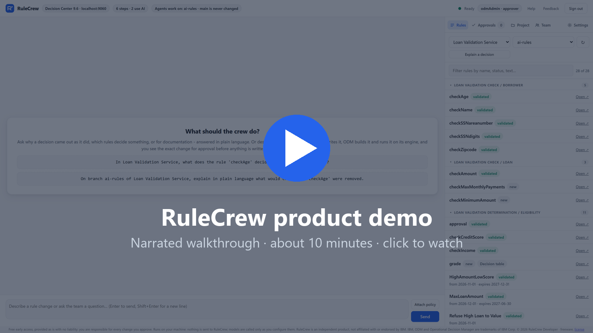

# RuleCrew™

**A companion for IBM® Operational Decision Manager (ODM) teams: AI agents that help you change, check and explain
the rules you already have.**

RuleCrew works alongside your ODM. It does not replace Rule Designer, Decision Center or the Rule Execution Server:
it uses them. Describe a business change in plain English and RuleCrew's agents find the affected rules, decision
tables and ruleflows, write the change, build it with ODM's own build command and run it before and after on ODM's
own engine. You review every file before anything is written, and approved changes go into your normal ODM workflow.

**What it helps with**
- **From policy to a tested change:** the change, its examples and the evidence, ready for your review.
- **Knowing what a change affects:** known decisions are replayed before and after, and what moved is shown.
- **Answers for business users:** questions about existing rules, answered from the rules and ODM's engine.
- **Checks without any AI model:** health check, explain a decision, baseline, impact and dates.

**Our aim** is to save ODM teams time from request to approved change. We have not measured that yet; the
[benchmark](BENCHMARK.md) shows what has been measured so far.

> **Free for now, no liability.** RuleCrew is free to use during early access. It is provided as is, without
> warranty, and its author accepts no liability for any loss or damage from its use - you review, test and approve
> every change before it reaches production. See [No liability](#no-liability) and the [license](LICENSE).

## Demo videos

**[Watch the 13-minute overview on YouTube](https://youtu.be/gS_DsnHsF78)** - business questions answered from ODM's
engine, a change in a Rule Designer workspace, a Decision Center change approved by two people, and a live decision on
the Rule Execution Server.

Short videos by topic:
- [Ask about your rules in plain English](https://youtu.be/ok7-_NKXZTw) (3:34)
- [Why did this request get this decision?](https://youtu.be/hVP9DtpmvYI) (3:32)
- [Documentation of a rule project, generated](https://youtu.be/SJdkgSrLF-A) (2:56)
- [Test cases and test data, explained](https://youtu.be/L-mTyFXLQcQ) (2:30)
- [A rule change in a Rule Designer workspace](https://youtu.be/lHOgIPHvlOs) (2:17)
- [A Decision Center change, approved by two people](https://youtu.be/Ngq13GI8XeE) (2:14)
- [Checks that need no AI model](https://youtu.be/WBkbXwIyriE) (2:32)
- [What's coming next (planned)](https://youtu.be/8uBt1h2eB68) (1:13)

Recorded with IBM's free developer editions (IBM ODM for Developers and Rule Designer), used under IBM's terms for development and testing. RuleCrew does not include any IBM software.

All videos can also be downloaded in full quality from the
[demo release](https://github.com/RuleCrew/RuleAgents/releases/tag/demo-2026-11-10).

> **Runs entirely on your machine.** RuleCrew has no cloud service and sends nothing to RuleCrew or its author -
> no telemetry, analytics, usage data or crash reports. Your rules, data and settings stay on your
> computers and your own ODM servers. The only calls that leave your network are to the language model **you**
> choose and configure (for example your Anthropic, OpenAI, Azure OpenAI, Amazon Bedrock or Google Vertex AI account,
> your company's AI gateway, or a model hosted inside your network), under your own agreement with that provider. If you allow it, RuleCrew also asks GitHub once a day for the
> latest version number - nothing about you or your rules is sent. See [PRIVACY.md](PRIVACY.md).

## Why RuleCrew
- **Built for existing rule projects.** RuleCrew is made for maintaining rule projects you already have (brownfield):
  it reads your rules, decision tables, ruleflows and data model before it changes anything.
- **Checked before you see it.** Every change is built with IBM's build command, run on ODM's engine and
  regression-checked against known decisions. A draft that fails a check is rejected internally and never offered
  for approval.
- **Bring your own AI model.** Anthropic, OpenAI, Azure OpenAI, Amazon Bedrock, Google Vertex AI, or a model inside
  your network through your company's gateway. Your rules go only to the provider you choose.
- **Explains decisions in plain words.** It runs a decision, reads the trace of which rules fired, and tells you why
  the outcome is what it is.
- **Writes tests for you.** Test scenarios with expected results, boundary values included - see below.

## Tests it writes for you
Ask for tests of a rule or a behaviour ("write tests for the maximum amount rules"). RuleCrew:
- Writes 4 to 12 scenarios, each with a short id, a one-line description, input values and expected results.
- For every threshold in a condition, tests just below, at and just above the boundary; for each rule, a case where
  it fires and one where it does not.
- Runs each scenario on the current build and compares the actual results and the rules that fired with the
  expectations. A scenario that still differs after review is left out of the suite and shown to you with the
  evidence - it may point at a real rule problem.
- Proposes the rest as a Decision Center test suite (Excel scenarios). Nothing is added until you approve it.

## What it does

**For business users - understand your decisions, in plain language**
- **"Why was this application refused?"** Paste the transaction (request data) or describe it: RuleCrew runs it on
  ODM's engine (embedded, or your test Rule Execution Server), traces which rules fired and which did not, and explains in everyday words why
  the outcome is what it is - and what would have to change to get the expected result.
- **"Which rules decide X?"** Ask about any part of the logic - eligibility, pricing, limits, dates - and get the
  rules involved, their conditions and their order, without reading rule code.
- **"Write the documentation"** - a readable description of a decision service: its flow, rules and data model,
  produced from the rules themselves.

**For rule developers and maintainers - change rules safely**
- **Changes rules from plain English** - action rules, decision tables and ruleflows; a data model follows your XOM through BOM Update.
- **Works where your rules are** - in Decision Center (on a working branch; `main` is never changed), or in a Rule
  Designer workspace folder (approved changes are written there uncommitted; you commit). No plug-in is needed.
- **Checks every change on ODM's engine** - the build must pass, examples run before and after, changed decision-table
  rows are run, known decisions are replayed, and critics try to break the change. The card says what ran and what
  did not. A change that fails a check is not offered as ready.
- **Tests it writes for you** - requirement and boundary examples, regression replay of known (or production)
  decisions, and Decision Center test suites (Excel scenarios); every approved decision becomes a re-runnable suite.
- **Prove my change** - checks any change in your workspace, whoever wrote it, with no language model.
- **You stay in control** - nothing is applied without your approval; every action is in a local audit log.

**What "proven" means, and what it does not.** Proven means every required check ran and passed on the examples and
known decisions RuleCrew had. It does not guarantee the change is what your policy means: a misreading made the same
way in the rule and its examples passes every check. Inputs nobody tried are not covered, and a limit the boundary
check cannot read is said on the card and relies on the examples. A person still reads every change.

See the step-by-step [Getting started guide](GETTING_STARTED.md).

## Download
**The download is coming soon** on [Releases](../../releases). Until then, watch the [demo videos](#demo-videos).
Container images are not published yet.

What the download will be: a Windows zip with the desktop application (Java included). Unzip, run
`odm-rule-agent.exe`; the browser opens at `http://localhost:8765`; fill in Settings.

A Rule Designer plug-in is an optional early-access add-on. Its chat works only on the workspace open in Rule
Designer; Decision Center work happens on the web page.

**Updates.** RuleCrew can tell you when a new version is out (you are asked at first start). Unzip a new version
anywhere - your setup is saved once (in `%LOCALAPPDATA%\RuleCrew`) and every version uses it. Each early-access
version expires about six months after its release date (shown in the app): after that it still explains, checks
and tests, but applies no change. Newer early-access versions are free.

**Free during early access.** RuleCrew is free while it is in early access. Later versions may add paid editions or
paid features (for example team features and support); any such change will be announced in the release notes
before that version is published, and a version you already have keeps the terms it came with.

**Windows SmartScreen.** `odm-rule-agent.exe` is not code-signed yet, so Windows SmartScreen may block the first
start. To run it, click **More info**, then **Run anyway**. If your company requires signed software, your IT team
can sign `odm-rule-agent.exe` with its internal code-signing certificate before rolling it out.

## Requirements
- Windows 10 or 11, 64-bit. Linux and macOS versions are available on request: reach out to us and we will provide
  one for your team.
- **Your own licensed IBM ODM** (9.0, 9.5 and 9.6 supported; 8.11 and 8.12 experimental). IBM ODM is **not** included. RuleCrew was developed and tested
  against IBM ODM 9.6 using IBM's publicly available *IBM ODM for Developers* container image, under IBM's terms
  for that image; this does not imply any review, certification or endorsement by IBM.
- A language model you provide: Anthropic, OpenAI, Azure OpenAI (key or Microsoft Entra ID), Amazon Bedrock (API key,
  access keys or AWS profile), Google Vertex AI, many other providers listed in Settings, or any OpenAI-compatible
  endpoint (your company gateway, or a model you host). Tested end to end with Anthropic Claude; other providers
  use the same standard interface - please report what you find.

## Tailored to your organisation
RuleCrew can be customised to your needs - for example your AI provider or company gateway, your branch and review
conventions, approval rules (four-eyes, who may approve), your naming and documentation standards, additional checks,
and integration with your CI/CD or ticketing. Tell us what you need: [open an issue](../../issues/new).

## Status
**No liability.** RuleCrew is free early-access software that is still being improved. It is provided as is, without warranty, and its author accepts no liability for any loss or damage from its use - including rule changes it proposes, decisions your rules make, or anything written to your systems. Using it, and reviewing, testing and approving every change before it reaches production, is entirely your own responsibility. The [license](LICENSE) has the binding terms.

Early release, free to use. Results of the agents vary between runs; RuleCrew's checks stop changes that fail
them, but you remain responsible for reviewing and testing every change before it reaches production.
Problems and questions: [Issues](../../issues). Security problems: see [SECURITY.md](SECURITY.md).

## License and trademarks
RuleCrew is proprietary software, free to use under the [RuleCrew Freeware License Agreement](LICENSE): free for
individuals and organizations, no redistribution, modification or reverse engineering, provided as is without
warranty. Your rules, data and the changes RuleCrew drafts are yours; you remain responsible for reviewing them and
for the decisions your rules make. Third-party components: [THIRD_PARTY_NOTICES.md](THIRD_PARTY_NOTICES.md).

RuleCrew is an independent product, not affiliated with, sponsored by, endorsed by or supported by IBM. IBM, IBM
Operational Decision Manager, ODM, Decision Center, Rule Designer and Rule Execution Server are trademarks or
registered trademarks of IBM Corp., in the US or other countries or both. See [TRADEMARKS.md](TRADEMARKS.md).
